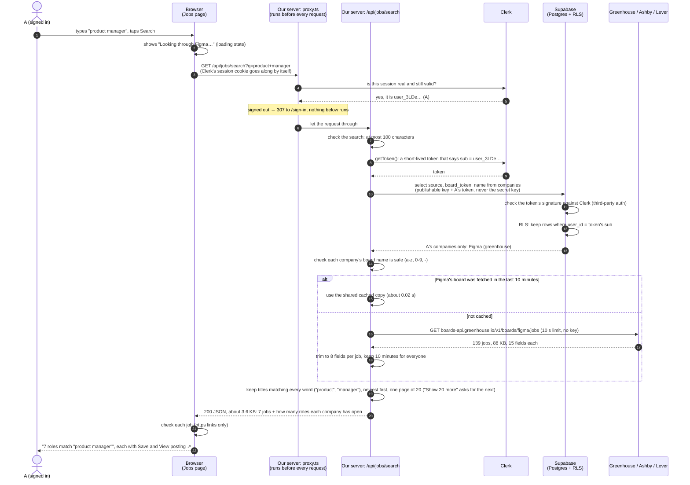
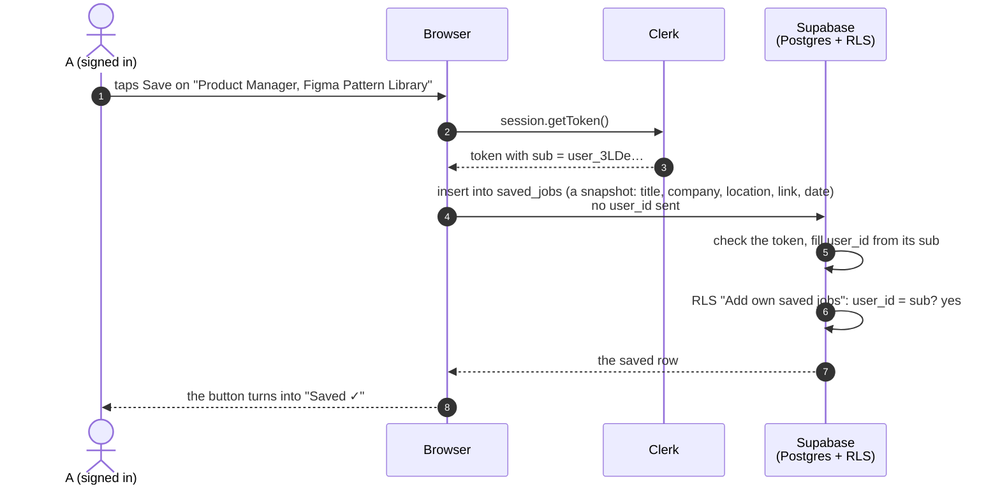

# One request, from the click to the screen

Assignment 4, step 6: "Draw a diagram of one request, from the click to the screen: the browser, my server, Clerk, Supabase, and the API."

The request is **Search** on the Jobs page: someone signed in as A types "product manager" and taps Search. It touches all five parts. A second, shorter diagram follows for **Save**, which goes from the browser straight to Supabase.

## Search: browser → our server → Clerk → Supabase → job boards → screen

What can go wrong, and what the screen says:

| Where | What happens | What A sees |
|---|---|---|
| proxy.ts | not signed in | sent to the sign-in page |
| route | search longer than 100 characters | "Keep the search under 100 characters" |
| Supabase | companies can't be read | "The hiring systems didn't answer, try again in a minute" + Try again |
| job boards | one system doesn't answer within 10 s | "Palantir didn't answer, showing the rest" |
| job boards | none answer | "The hiring systems didn't answer, try again in a minute" + Try again; the companies still show |
| result | nothing matches | "No roles match "…" at your companies right now, try a shorter title like "designer"" |

## Save: browser → Clerk → Supabase (our server is not involved)

The job boards aren't called here: the snapshot already came with the search. Our server isn't either: the browser can talk to Supabase directly because row-level security, not the server, decides what each person may touch.

## Why the job boards are called on the server, not in the browser

- **Size and caching:** a raw board is up to 13.5 MB (OpenAI on Ashby). The server trims it, keeps one copy for everyone for 10 minutes, and sends the browser a few KB.
- **Rate limits:** with the shared cache, a company is fetched at most once every 10 minutes, however many people follow it.
- **Safety:** the browser never chooses the address we call. The list of companies comes from the person's own rows in Supabase, and every board name is checked before it goes into an address.
- **Not keys:** Greenhouse, Ashby and Lever need no key, so hiding one is not the reason.
